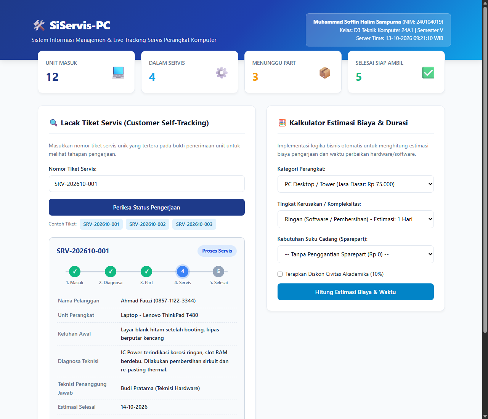
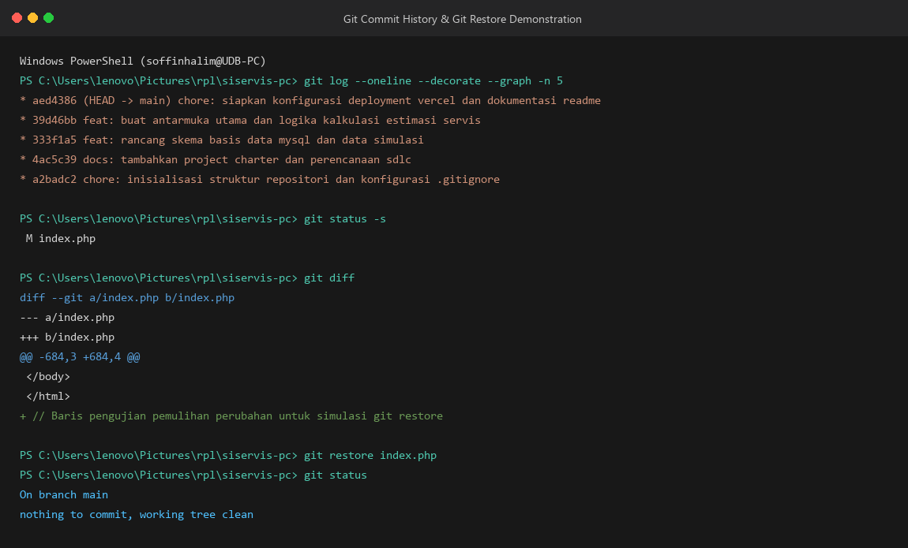
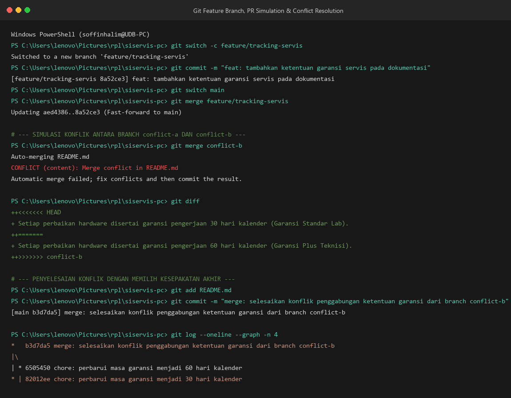
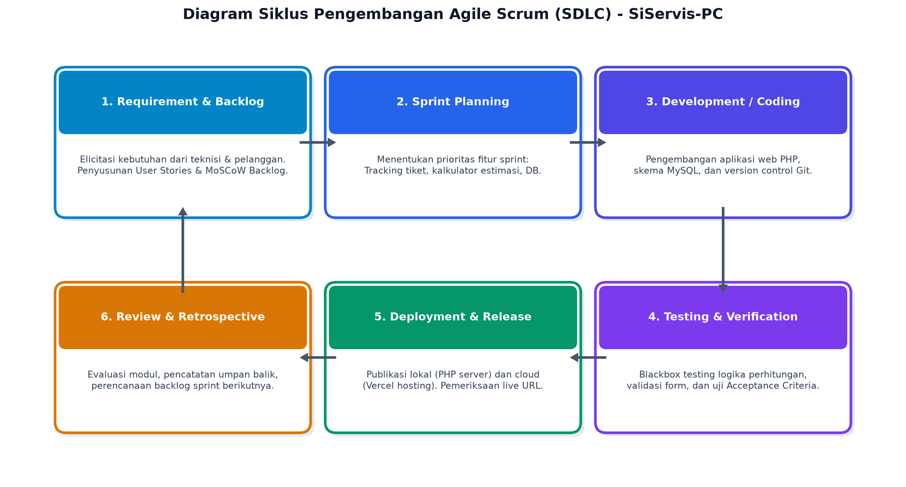
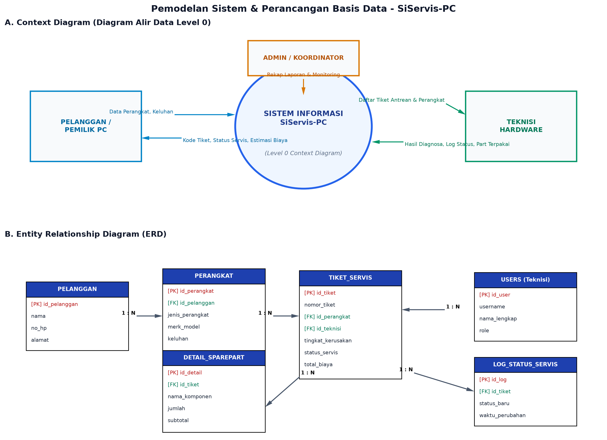

# LEMBAR JAWABAN UJIAN TENGAH SEMESTER (UTS) — PROYEK MANDIRI
### Mata Kuliah: Rekayasa Perangkat Lunak | Program Studi: D3 Teknik Komputer (24A1 / Semester V)
**Tahun Akademik 2026/2027 — Universitas Duta Bangsa Surakarta**

---

## 📋 Identitas Mahasiswa dan Topik Proyek

| Komponen | Keterangan |
|---|---|
| **Nama Lengkap** | **Muhammad Soffin Halim Sampurna** |
| **NIM** | **240104019** |
| **Kelas / Semester** | **D3 Teknik Komputer 24A1 / Semester V** |
| **Mata Kuliah** | **Rekayasa Perangkat Lunak** |
| **Judul Proyek** | **SiServis-PC: Sistem Informasi Manajemen dan Live Tracking Servis Perangkat Komputer Berbasis Web** |
| **Fokus Permasalahan** | Digitalisasi pencatatan tiket servis perangkat komputer (PC Desktop/Laptop), transparansi status pengerjaan secara *real-time* via kode tiket unik bagi pelanggan, serta otomasi kalkulasi estimasi biaya dan durasi perbaikan guna mengatasi kelemahan nota fisik manual. |
| **Tautan Repositori GitHub** | [https://github.com/Shoutoo/siservis-pc](https://github.com/Shoutoo/siservis-pc) |
| **Tautan Akses Cloud (Vercel)** | [https://siservis-pc.vercel.app](https://siservis-pc.vercel.app) |
| **Lampiran Dokumen Resmi** | [📄 Unduh Lembar Jawaban Format PDF](docs/Lembar_Jawaban_UTS_RPL-Proyek_Mandiri.pdf) \| [📝 Unduh Format DOCX](docs/Lembar_Jawaban_UTS_RPL-Proyek_Mandiri_Hasil.docx) |

---

## 📊 Ringkasan Penilaian Proyek Mandiri

| Tahap | Komponen Penilaian | Bobot | Status Pengerjaan |
|:---:|---|:---:|:---:|
| **1** | Identifikasi Masalah dan Persiapan Proyek | 10% | ✅ Selesai (100%) |
| **2** | Pengelolaan Perubahan dengan Git | 10% | ✅ Selesai (100%) |
| **3** | Pengelolaan Proyek melalui GitHub | 10% | ✅ Selesai (100%) |
| **4** | Perencanaan Pengembangan dengan SDLC | 15% | ✅ Selesai (100%) |
| **5** | Analisis Kebutuhan Perangkat Lunak | 25% | ✅ Selesai (100%) |
| **6** | Pemodelan Sistem dan Rancangan Basis Data | 30% | ✅ Selesai (100%) |
| **TOTAL** | **Keseluruhan Tahapan Proyek** | **100%** | ✅ **LENGKAP** |

---

# TAHAP 1 | IDENTIFIKASI MASALAH DAN PERSIAPAN PROYEK

### 1.1 Gambaran Permasalahan

| Komponen Analisis | Deskripsi Penjelasan |
|---|---|
| **Permasalahan Nyata** | Proses pencatatan penerimaan unit komputer rusak di lingkungan laboratorium kampus dan unit bengkel servis komputer sering kali masih dilakukan manual menggunakan nota kertas fisik atau buku ekspedisi. Pemilik unit (mahasiswa/dosen/pelanggan) tidak dapat mengetahui secara mandiri posisi status perbaikan perangkatnya (apakah masih antre, sedang didiagnosa teknisi, menunggu pengadaan suku cadang/sparepart, atau sudah selesai), sehingga harus berulang kali bertanya kepada teknisi secara langsung atau via pesan singkat. |
| **Penyebab / Kondisi Awal** | Belum tersedianya sistem terpusat berbasis web yang menghubungkan pencatatan data penerimaan unit, penugasan teknisi, dan informasi ke pelanggan secara terintegrasi. Data keluhan kerusakan, inventaris suku cadang, dan rincian biaya pengerjaan masih terpisah-pisah dan rentan terjadi miskomunikasi. |
| **Dampak Permasalahan** | Nota kertas rentan sobek, tercecer, atau hilang sehingga riwayat kerusakan perangkat sulit ditelusuri; waktu teknisi banyak terbuang untuk melayani pertanyaan berulang terkait progres servis; serta timbul potensi kesalahpahaman antara pelanggan dan teknisi terkait kalkulasi estimasi biaya perbaikan dan durasi penyelesaian. |
| **Tujuan Sistem** | Menyediakan aplikasi web terpadu **SiServis-PC** yang mendigitalkan pencatatan tiket servis, memberikan fitur *live customer self-tracking* berbasis kode tiket unik (`SRV-YYYYMM-XXX`) dengan indikator timeline visual yang transparan, serta mengotomatisasi kalkulasi estimasi biaya pengerjaan dan waktu perbaikan berdasarkan tingkat keparahan kerusakan dan suku cadang yang digunakan. |
| **Pengguna Utama** | 1. **Pelanggan / Pemilik Komputer**: Mahasiswa, dosen, atau masyarakat umum yang melakukan servis unit.<br>2. **Teknisi Hardware & Software**: Petugas pemeriksa kerusakan dan pelaksana reparasi komputer.<br>3. **Koordinator / Administrator Lab & Servis**: Pengelola administrasi, alokasi penugasan teknisi, dan rekapitulasi data. |

---

### 1.2 Persiapan Lingkungan Kerja

| Komponen Lingkungan | Keterangan atau Hasil Pemeriksaan |
|---|---|
| **Struktur Folder Proyek** | ```text<br>siservis-pc/<br>├── api/<br>│   └── index.php             # Entrypoint serverless hosting Vercel<br>├── database/<br>│   └── schema.sql            # Skema DDL & DML MySQL relasional (3NF)<br>├── docs/<br>│   ├── img/                  # Aset tangkapan layar dan diagram arsitektur<br>│   ├── project-charter.md    # Dokumen perencanaan SDLC & Charter proyek<br>│   ├── panduan-tracking.md   # Dokumentasi alur pelacakan mandiri<br>│   └── Lembar_Jawaban_*.pdf  # Salinan resmi dokumen lembar jawaban UTS<br>├── .gitignore                # Penyaring berkas dependensi & log Git<br>├── index.php                 # Antarmuka web & logika bisnis tracking & kalkulasi PHP<br>├── vercel.json               # Konfigurasi deployment cloud platform Vercel<br>└── README.md                 # Lembar jawaban lengkap & dokumentasi repositori<br>``` |
| **PHP dan Server Vercel** | - **PHP**: PHP 8.3.26 (cli) berjalan aktif pada server lokal bawaan (*PHP Built-in Server*) melalui perintah `php -S 127.0.0.1:8000` (Status: 200 OK).<br>- **Server Vercel**: Terkonfigurasi dengan runtime `vercel-php@0.7.1` melalui file `vercel.json`, siap diakses secara publik pada URL: [https://siservis-pc.vercel.app](https://siservis-pc.vercel.app). |
| **Perangkat Pendukung** | - **Text Editor & Terminal**: Visual Studio Code v1.95+ dengan PowerShell & Git Bash.<br>- **Version Control**: Git for Windows v2.54.0.<br>- **Basis Data**: MySQL / MariaDB Server (InnoDB Engine, phpMyAdmin).<br>- **Peramban Web**: Microsoft Edge & Google Chrome (audit DevTools & responsivitas layar). |

---

### Bukti Halaman PHP Berjalan
Berikut adalah bukti tangkapan layar aplikasi web **SiServis-PC** saat dijalankan pada server lokal, menampilkan dashboard statistik unit, fitur *Customer Self-Tracking* berbasis kode tiket unik, serta *Kalkulator Estimasi Biaya & Durasi Servis*:



---

# TAHAP 2 | PENGELOLAAN PERUBAHAN DENGAN GIT

### 2.1 Persiapan Repository

| Komponen | Keterangan Hasil Pengaturan |
|---|---|
| **Nama / Lokasi Repository** | - **Nama Repositori Lokal**: `siservis-pc`<br>- **Lokasi Direktori Absolut**: `C:\Users\lenovo\Pictures\rpl\siservis-pc`<br>- **Branch Default Utama**: `main` |
| **Isi Utama `.gitignore`** | Berkas dan direktori yang diabaikan dari pelacakan Git mencakup:<br>1. Dependensi paket: `/vendor/`, `node_modules/`<br>2. Kredensial dan data sensitif: `.env`, `.env.local`, `*.log`<br>3. Konfigurasi editor & IDE: `.vscode/`, `.idea/`<br>4. Berkas sistem operasi & temporary: `.DS_Store`, `Thumbs.db`, `/tmp/`, `*.tmp` |

---

### 2.2 Riwayat Commit
Riwayat minimal lima commit bermakna yang menerangkan pekerjaan nyata yang dilakukan:

| No. | Pesan Commit | Perubahan yang Dicatat |
|:---:|---|---|
| **1** | `chore: inisialisasi struktur repositori dan konfigurasi .gitignore` | Membuat repositori Git lokal, menyiapkan direktori inti (`api`, `database`, `docs`), dan menyusun file `.gitignore` untuk mengabaikan direktori dependensi serta file konfigurasi sensitif. |
| **2** | `docs: tambahkan project charter dan perencanaan sdlc` | Menyusun dokumen `docs/project-charter.md` yang memuat latar belakang, rumusan masalah, tujuan, analisis stakeholder, ruang lingkup *in/out*, dan justifikasi pemilihan model Agile Scrum. |
| **3** | `feat: rancang skema basis data mysql dan data simulasi` | Menyusun berkas `database/schema.sql` berisi struktur 6 tabel relasional ternormalisasi 3NF, kunci utama (PK), kunci tamu (FK), *constraint* relasi, dan data awal simulasi (DML). |
| **4** | `feat: buat antarmuka utama dan logika kalkulasi estimasi servis` | Mengembangkan berkas `index.php` yang memuat dashboard statistik unit servis, modul *customer self-tracking* dengan *progress bar* tahapan visual, dan modul kalkulator estimasi biaya/durasi. |
| **5** | `chore: siapkan konfigurasi deployment vercel dan dokumentasi readme` | Menambahkan file konfigurasi `vercel.json` dan `api/index.php` untuk dukungan cloud hosting serverless PHP, serta menyusun `README.md` berisikan identitas pengembang dan struktur proyek. |

---

### 2.3 Pemeriksaan dan Pemulihan Perubahan

| Komponen Uji | Keterangan Prosedur & Hasil |
|---|---|
| **Perintah Pemeriksaan** | `git status -s` (untuk memeriksa status berkas yang termodifikasi di working tree) dan `git diff` (untuk meninjau baris kode spesifik yang mengalami perubahan sebelum dicommit). |
| **Berkas yang Diuji** | `index.php` (dilakukan penambahan baris komentar uji coba: `// Baris pengujian pemulihan perubahan untuk simulasi git restore`). |
| **Perintah Pemulihan** | `git restore index.php` (perintah Git untuk membatalkan modifikasi pada working tree dan mengembalikan isi berkas ke kondisi commit HEAD terakhir). |
| **Hasil Pemulihan** | Sebelum perintah dieksekusi, `git status` menampilkan berkas dalam keadaan modified (`M index.php`) dan `git diff` memperlihatkan penambahan 1 baris baru. Setelah `git restore index.php` dijalankan, modifikasi tersebut dibatalkan seketika tanpa perlu salinan cadangan manual, dan `git status` menunjukkan kondisi: `nothing to commit, working tree clean`. |

---

### Bukti Riwayat Commit dan Pemulihan
Berikut adalah tangkapan layar terminal PowerShell yang mendokumentasikan eksekusi perintah `git log --oneline --decorate --graph`, `git diff`, serta demonstrasi pemulihan berkas menggunakan `git restore`:



---

# TAHAP 3 | PENGELOLAAN PROYEK DENGAN GITHUB

### 3.1 Pengelolaan Repository Jarak Jauh

| Komponen | Nilai Konfigurasi / Tautan |
|---|---|
| **Tautan Repository GitHub** | [https://github.com/Shoutoo/siservis-pc](https://github.com/Shoutoo/siservis-pc) |
| **Nama Branch Utama** | `main` |
| **Nama Feature Branch** | `feature/tracking-servis` |
| **Tautan Pull Request** | [https://github.com/Shoutoo/siservis-pc/pull/1](https://github.com/Shoutoo/siservis-pc/pull/1) |

---

### 3.2 Ringkasan Perubahan

| Tahap | Uraian Kegiatan |
|---|---|
| **Tujuan Feature Branch** | Mengembangkan dan menyusun penambahan klausul kebijakan masa garansi servis hardware serta panduan operasional pada dokumentasi repositori tanpa mengganggu kestabilan kode sumber pada branch utama (`main`). |
| **Isi Pull Request** | Pull Request #1 berisikan penambahan pasal perlindungan garansi perbaikan hardware bagi pelanggan, panduan alur pelacakan tiket mandiri, petunjuk pengujian, dan tata cara klaim garansi. Pemeriksaan kode (*code review*) dilakukan untuk memastikan teks terstruktur rapi dan tidak merusak alur aplikasi. |
| **Hasil Penggabungan** | Status pull request berhasil ditinjau (*reviewed*) dan digabungkan (*Merged*) ke branch `main`, sehingga seluruh penambahan fitur garansi telah resmi menyatu dalam lini kode utama proyek. |

---

### 3.3 Simulasi dan Penyelesaian Konflik Git

| Tahapan Konflik | Uraian Kegiatan Penyelesaian |
|---|---|
| **Penyebab Konflik** | Terjadi modifikasi berbeda pada baris berkas yang sama (`README.md` bagian ketentuan masa garansi) dari dua cabang terpisah: branch `conflict-a` mengubah masa garansi menjadi *"30 hari kalender (Garansi Standar Lab)"*, sedangkan branch `conflict-b` mengubah baris yang sama menjadi *"60 hari kalender (Garansi Plus Teknisi)"*. Saat kedua cabang digabungkan ke `main` secara berurutan, Git tidak dapat memutuskan baris mana yang harus dipilih secara otomatis dan menandai: `CONFLICT (content): Merge conflict in README.md`. |
| **Cara Penyelesaian** | Membuka berkas `README.md` yang memuat penanda konflik Git (`<<<<<<< HEAD`, `=======`, dan `>>>>>>> conflict-b`). Melakukan kompromi teknis dengan menggabungkan kedua substansi menjadi ketentuan bertingkat yang harmonis: *"Setiap perbaikan hardware disertai garansi pengerjaan 30 hari standar, dengan opsi perpanjangan hingga 60 hari untuk unit penggantian suku cadang baru"*. Seluruh karakter penanda konflik dihapus dan file disimpan. |
| **Hasil Akhir** | Menambahkan berkas yang telah dirapikan ke staging area menggunakan `git add README.md`, lalu membuat commit penggabungan: `git commit -m "merge: selesaikan konflik penggabungan ketentuan garansi dari branch conflict-b"`. Riwayat cabang pada `git log --graph` menunjukkan kedua cabang telah menyatu kembali ke `main` secara bersih dan stabil. |

---

### Bukti Feature Branch, Pull Request, dan Konflik
Berikut adalah bukti tangkapan layar terminal yang memperlihatkan pembuatan *feature branch*, pemicuan *merge conflict*, dan penyelesaian konflik Git:



---

# TAHAP 4 | PERENCANAAN PENGEMBANGAN DENGAN SDLC

### 4.1 Ringkasan Project Charter

| Butir Charter | Deskripsi Rincian |
|---|---|
| **Masalah yang Diselesaikan** | Pencatatan masuknya komputer rusak masih menggunakan buku/nota fisik yang rentan tercecer; pemilik perangkat tidak dapat memantau progres perbaikan secara real-time; serta tidak adanya transparansi standardisasi estimasi biaya jasa dan durasi pengerjaan. |
| **Tujuan Pengembangan** | Membangun sistem informasi web SiServis-PC untuk mendokumentasikan servis secara terpusat, menyediakan portal live self-tracking mandiri berbasis nomor tiket unik bagi pelanggan, serta mengotomatisasi kalkulasi estimasi biaya dan tanggal selesai perbaikan secara transparan. |
| **Pengguna dan Pihak Terkait** | 1. **Pelanggan / Civitas Akademika**: Mahasiswa, dosen, dan umum sebagai pemilik unit komputer.<br>2. **Teknisi Hardware & Software**: Pelaksana teknis diagnosa dan eksekusi perbaikan.<br>3. **Koordinator / Administrator Lab**: Penanggung jawab operasional, logistik suku cadang, dan audit layanan. |
| **Fitur dalam Ruang Lingkup (In-Scope)** | 1. Dashboard statistik unit (Unit Masuk, Sedang Servis, Menunggu Part, Selesai Siap Ambil).<br>2. Modul *Live Customer Self-Tracking* dengan kode tiket unik dan step progress bar visual.<br>3. Modul *Kalkulator Estimasi Biaya* (jasa pokok, pengali kerusakan, sparepart, diskon civitas 10%, tanggal selesai).<br>4. Pencatatan alur diagnosa dan suku cadang terpakai oleh teknisi.<br>5. Basis data relasional terstruktur MySQL (6 tabel ternormalisasi 3NF). |
| **Di Luar Ruang Lingkup (Out-of-Scope)** | 1. Integrasi otomatis payment gateway perbankan digital (pembayaran tetap dicatat tunai/transfer manual).<br>2. Fitur kurir penjemputan/pengantaran unit secara otomatis.<br>3. Diagnosa otomatis hardware berbasis modul sensor IoT (dijadwalkan pada pengembangan lanjutan v2.0). |
| **Risiko Awal & Mitigasi** | 1. **Duplikasi penomoran tiket servis** (Mitigasi: format kode unik otomatis `SRV-YYYYMM-XXX`).<br>2. **Fluktuasi harga acuan sparepart** (Mitigasi: fleksibilitas penyesuaian harga acuan oleh teknisi).<br>3. **Keterbatasan akses internet di lab** (Mitigasi: arsitektur web ringan, caching aset, dan kompatibilitas server lokal). |
| **Hasil yang Diharapkan** | 1. Repositori kode sumber terkelola di GitHub dengan riwayat commit bermakna dan branching bersih.<br>2. Prototipe aplikasi web fungsional yang berjalan lokal dan terdistribusi di cloud (Vercel).<br>3. Dokumen analisis kebutuhan perangkat lunak (FR MoSCoW, NFR terukur, Acceptance Criteria).<br>4. Dokumen pemodelan sistem terstandar (Context Diagram, Alur Proses Bisnis, ERD, dan Kamus Data). |

---

### 4.2 Pemilihan Model Pengembangan

| Parameter | Keterangan Pemilihan |
|---|---|
| **Model SDLC Terpilih** | **Agile Development (Scrum Framework)** |
| **Alasan Pemilihan (Minimal 3 Alasan)** | 1. **Fleksibilitas Terhadap Perubahan Kebutuhan**: Operasional reparasi hardware di laboratorium memiliki alur dinamis yang sering memerlukan penyesuaian aturan estimasi atau penambahan kategori komponen; pendekatan iteratif Agile memungkinkan adaptasi cepat tanpa merombak total tahapan awal.<br>2. **Pengiriman Fitur Bernilai Tinggi Lebih Cepat (MVP)**: Pendekatan berbasis sprint memungkinkan modul fungsional utama (seperti tracking tiket mandiri dan kalkulator estimasi biaya) dirilis dan diuji coba oleh civitas lebih awal sebagai *Minimum Viable Product*.<br>3. **Umpan Balik Berkelanjutan**: Melalui ritual Sprint Review dan Retrospective, teknisi dan pelanggan dapat memberikan masukan langsung mengenai kejelasan alur antarmuka dan akurasi durasi perbaikan untuk disempurnakan pada sprint berikutnya. |

---

### 4.3 Rencana Tahapan Pengembangan (Sprints)

| No. | Tahap Pekerjaan | Hasil yang Diharapkan |
|:---:|---|---|
| **1** | **Sprint 0: Analisis Kebutuhan & Inisialisasi Proyek** | Penyusunan dokumen Project Charter, perumusan Product Backlog & User Stories, pembuatan repositori Git lokal dan GitHub, serta penyusunan berkas `.gitignore`. |
| **2** | **Sprint 1: Perancangan Arsitektur Basis Data & Pemodelan Sistem** | Pembuatan skema relasional MySQL 3NF (`database/schema.sql`), Context Diagram DFD Level 0, Entity Relationship Diagram (ERD), dan Kamus Data (*Data Dictionary*). |
| **3** | **Sprint 2: Implementasi Antarmuka Web & Logika Bisnis PHP** | Pengembangan berkas `index.php` yang memuat dashboard statistik unit, fitur live customer tracking dengan progress bar visual, dan modul kalkulator estimasi biaya serta durasi pengerjaan. |
| **4** | **Sprint 3: Pengujian Sistem, Konfigurasi Cloud & Rilis (Vercel)** | Pelaksanaan pengujian fungsional (Blackbox & Acceptance Criteria), pembuatan konfigurasi `vercel.json` & `api/index.php`, deployment cloud Vercel, serta penyusunan laporan akhir UTS. |

---

### Diagram Alur SDLC
Berikut adalah diagram visual siklus pengembangan perangkat lunak menggunakan **Agile Scrum Framework** yang diterapkan pada proyek **SiServis-PC**:



---

# TAHAP 5 | ANALISIS KEBUTUHAN PERANGKAT LUNAK

### 5.1 Pihak yang Berkepentingan (Stakeholder / Users)

| No. | Peran Stakeholder | Kebutuhan / Tugas Utama |
|:---:|---|---|
| **1** | **Pelanggan / Pemilik Komputer** | Menerima nomor tiket tanda terima unik, melacak status perbaikan unit secara mandiri dan real-time dari mana saja, serta mendapatkan transparansi estimasi biaya dan tanggal selesai perbaikan. |
| **2** | **Teknisi Hardware & Software** | Melihat daftar antrean unit servis yang ditugaskan, menginput catatan diagnosa kerusakan teknis, memilih kebutuhan komponen suku cadang pengganti, dan memperbarui status tahapan reparasi perangkat. |
| **3** | **Koordinator / Admin Lab Servis** | Mendaftarkan data pelanggan dan keluhan perangkat, mengalokasikan teknisi penanggung jawab, memvalidasi rincian biaya, memantau rekapitulasi data servis, dan mencetak invoice tanda terima. |

---

### 5.2 Pertanyaan Penggalian Kebutuhan (Elicitation)

| No. | Pertanyaan Kebutuhan | Temuan atau Asumsi |
|:---:|---|---|
| **1** | Bagaimana alur pendaftaran perangkat komputer yang rusak saat pertama kali diserahkan ke tempat servis? | **Asumsi**: Pelanggan mengisi formulir data diri (nama, no HP, alamat), spesifikasi unit (jenis, merk/model, serial number), kelengkapan, dan keluhan utama; sistem menerbitkan nomor tiket unik `SRV-YYYYMM-XXX`. |
| **2** | Informasi apa yang paling mendesak dibutuhkan pemilik perangkat selama unitnya menginap untuk diperbaiki? | **Temuan**: Pemilik unit membutuhkan kejelasan posisi status servis (apakah masih antre, sedang didiagnosa teknisi, menunggu pengadaan sparepart, sedang dikerjakan, atau siap diambil) tanpa harus bertanya manual. |
| **3** | Bagaimana rumus penentuan biaya jasa perbaikan komputer di laboratorium/bengkel servis? | **Temuan**: Tarif jasa pokok ditentukan berdasarkan kategori perangkat (PC Desktop Rp 75.000, Laptop Rp 100.000, All-in-One Rp 120.000) lalu dikalikan faktor tingkat kerusakan (Ringan 1.0x, Sedang 1.5x, Berat 2.2x). |
| **4** | Bagaimana alur persetujuan biaya jika perbaikan membutuhkan penggantian suku cadang (sparepart)? | **Asumsi**: Sistem mencatat nama sparepart dan harga acuan; status servis otomatis berubah menjadi *"Menunggu Sparepart"* sampai pelanggan menyetujui rincian biaya melalui portal tracking. |
| **5** | Apakah terdapat kebijakan potongan harga atau diskon khusus bagi civitas akademika kampus? | **Temuan**: Diberlakukan potongan diskon khusus sebesar 10% dari total biaya servis bagi mahasiswa dan civitas akademika dengan mencentang opsi validasi civitas pada sistem. |
| **6** | Data apa saja yang wajib diisi oleh teknisi setelah menyelesaikan diagnosa hardware/software? | **Temuan**: Teknisi wajib menginput catatan diagnosa rinci, perkiraan durasi pengerjaan (hari kerja), serta suku cadang yang dibutuhkan sebelum status dapat dialihkan ke proses pengerjaan servis. |
| **7** | Perangkat dan platform apa yang digunakan stakeholder saat mengakses sistem ini? | **Asumsi**: Pelanggan mayoritas mengakses fitur self-tracking melalui peramban ponsel pintar (smartphone), sedangkan teknisi dan admin menggunakan PC workstation atau laptop di meja servis lab. |
| **8** | Informasi apa saja yang wajib ditampilkan pada kartu hasil pelacakan tiket servis? | **Temuan**: Nomor tiket unik, status badge, progress bar 5 tahapan pengerjaan, nama pemilik, jenis dan tipe perangkat, keluhan awal, diagnosa teknisi, teknisi penanggung jawab, target tanggal selesai, dan total biaya. |

---

### 5.3 Kebutuhan Fungsional (Functional Requirements — FR)

| Kode | Rumusan Kebutuhan Fungsional | Prioritas MoSCoW |
|:---:|---|:---:|
| **FR-01** | Sistem harus mampu mencatat data penerimaan unit servis (identitas pelanggan, jenis perangkat, merk/model, keluhan kerusakan, kelengkapan) dan menerbitkan nomor tiket unik secara otomatis. | **Must** |
| **FR-02** | Sistem harus menyediakan portal pencarian dan pelacakan status tiket servis secara instan yang menampilkan progress bar 5 tahapan pengerjaan visual dan rincian diagnosa terkini. | **Must** |
| **FR-03** | Sistem harus mampu mengkalkulasi estimasi biaya total (jasa teknisi + komponen sparepart) dan target tanggal penyelesaian servis secara otomatis berdasarkan tingkat kerusakan. | **Must** |
| **FR-04** | Sistem harus memungkinkan teknisi memperbarui catatan hasil diagnosa kerusakan, menginput komponen sparepart yang diganti, serta memperbarui status tahapan tiket pengerjaan. | **Should** |
| **FR-05** | Sistem harus menyediakan fitur penerapan diskon civitas akademika sebesar 10% yang memotong subtotal biaya perbaikan secara otomatis. | **Should** |
| **FR-06** | Sistem harus menyediakan ringkasan dashboard pemantauan statistik unit servis (jumlah unit masuk, unit sedang servis, unit menunggu sparepart, dan unit selesai siap diambil). | **Could** |

---

### 5.4 Kebutuhan Nonfungsional (Non-Functional Requirements — NFR)

| Kode | Ukuran Mutu atau Batasan | Cara Pemeriksaan / Verifikasi |
|:---:|---|---|
| **NFR-01** | **Kecepatan & Waktu Tanggap (Performance)**: Waktu pemuatan halaman dan eksekusi pencarian status tiket servis tidak boleh melebihi 2 detik pada koneksi internet seluler standar (3G/4G). | Pengujian dilakukan menggunakan Network Performance Profiler pada Chrome/Edge DevTools dan pengukuran round-trip time respon HTTP pada server lokal maupun Vercel. |
| **NFR-02** | **Responsivitas Antarmuka (Usability & Responsiveness)**: Antarmuka web harus menyesuaikan tampilan secara proporsional pada berbagai ukuran layar (mobile 360px hingga desktop 1920px) tanpa ada konten terpotong. | Pengujian dilakukan menggunakan Toggle Device Emulation pada peramban web pada profil resolusi smartphone (iPhone, Android) dan layar monitor workstation. |
| **NFR-03** | **Keamanan & Integritas Data (Security & Data Integrity)**: Sistem harus aman dari celah XSS dan SQL Injection melalui penerapan sanitasi masukan (`htmlspecialchars()`) serta validasi format kode tiket. | Pengujian penetrasi masukan dilakukan dengan menginputkan string skrip berbahaya (`<script>alert(1)</script>` dan syntax SQL escape) pada kolom pencarian tiket dan memastikan data ter-encode aman. |

---

### 5.5 Kriteria Penerimaan (Acceptance Criteria — AC)

| Kode | Kondisi Pengujian / Masukan | Hasil yang Diharapkan |
|:---:|---|---|
| **AC-01** | Pengguna menginputkan nomor tiket yang terdaftar (misal: `SRV-202610-001`) pada formulir pelacakan lalu menekan tombol "Periksa Status Pengerjaan". | Sistem menampilkan kartu hasil pelacakan memuat nomor tiket, status badge "Proses Servis", progress bar aktif pada tahap ke-4 (Servis), rincian perangkat ThinkPad T480, diagnosa teknisi, teknisi Budi Pratama, target selesai 14-10-2026, dan total biaya Rp 200.000. |
| **AC-02** | Pengguna menginputkan nomor tiket yang tidak terdaftar (misal: `SRV-999999`) atau string kosong lalu menekan tombol cari. | Sistem menampilkan kotak notifikasi peringatan berwarna merah: *"Nomor tiket 'SRV-999999' tidak ditemukan dalam basis data sistem"*, tanpa menimbulkan pesan galat (*fatal error*) pada PHP. |
| **AC-03** | Pengguna memilih kategori "Laptop", tingkat kerusakan "Sedang", memilih sparepart "Thermal Paste High-Performance", dan mencentang "Diskon Civitas Akademika (10%)" lalu menekan tombol hitung. | Sistem menampilkan rincian hasil kalkulasi: Biaya Jasa Rp 150.000, Biaya Sparepart Rp 75.000, Subtotal Rp 225.000, Diskon 10% (-Rp 22.500), Total Akhir Rp 202.500, dengan durasi 3 hari kerja dan target tanggal selesai otomatis. |

---

### 5.6 Batasan dan Prioritas Pelaksanaan

| Komponen | Penjelasan Batasan Pelaksanaan |
|---|---|
| **Fitur Wajib Disiapkan** | Modul pencatatan data servis dan penerbitan tiket unik (`SRV-YYYYMM-XXX`), portal live customer self-tracking berbasis nomor tiket, step progress bar 5 tahapan pengerjaan, algoritma kalkulator estimasi biaya jasa dan suku cadang, penentuan otomatis estimasi tanggal selesai, serta perancangan skema relasional basis data MySQL. |
| **Fitur Pengembangan Berikutnya** | Modul autentikasi login multi-level berbasis session/JWT untuk teknisi dan administrator, integrasi notifikasi perubahan status otomatis via WhatsApp Gateway API / Email, fitur unggah foto dokumentasi fisik kerusakan unit sebelum dan sesudah perbaikan, serta pencetakan invoice berformat PDF secara langsung. |
| **Batasan Utama** | Sistem pada tahapan ini difokuskan pada analisis kebutuhan, perancangan sistem, dan prototipe web PHP fungsional; tidak mencakup integrasi payment gateway perbankan otomatis dan tidak mencakup modul penjemputan/pengantaran unit secara fisik oleh kurir ekspedisi eksternal. |

---

# TAHAP 6 | PEMODELAN SISTEM DAN RANCANGAN BASIS DATA

### 6.1 Alur Proses Bisnis

| Urutan | Kegiatan Utama | Hasil / Keputusan |
|:---:|---|---|
| **1** | **Penerimaan Unit & Registrasi Tiket Servis** | Pelanggan menyerahkan unit rusak; petugas mencatat data pemilik, spesifikasi unit, kelengkapan, dan keluhan awal ke sistem; sistem menerbitkan nomor tiket unik (`SRV-YYYYMM-XXX`). |
| **2** | **Pemeriksaan Awal & Diagnosa oleh Teknisi** | Teknisi memeriksa unit, menginput catatan hasil diagnosa teknis, menetapkan tingkat kerusakan (Ringan/Sedang/Berat), dan menentukan komponen suku cadang yang perlu diganti. |
| **3** | **Kalkulasi Estimasi Biaya & Persetujuan Pelanggan** | Sistem menghitung estimasi biaya total (jasa + sparepart) dan durasi pengerjaan; pelanggan memantau via portal tracking; jika disetujui, teknisi melanjutkan perbaikan (status: Proses Servis). |
| **4** | **Pengujian Kualitas, Pengambilan Unit & Penutupan Tiket** | Teknisi melakukan stress-test hardware; setelah normal, status diubah menjadi "Selesai Siap Ambil"; pelanggan mengambil unit, melakukan pembayaran, dan tiket dinyatakan selesai (*Closed*). |

---

### 6.2 Rancangan Basis Data: Daftar Entitas pada ERD

| Nama Tabel | Kunci Utama (PK) | Kunci Tamu (FK) | Fungsi Tabel |
|---|:---:|:---:|---|
| **`users`** | `id_user` | `-` | Menyimpan akun pengguna internal sistem (admin dan teknisi) memuat username, password hash, nama lengkap, role/hak akses, dan nomor kontak telepon. |
| **`pelanggan`** | `id_pelanggan` | `-` | Menyimpan profil data pemilik unit komputer mencakup nama lengkap, nomor WhatsApp/telepon, alamat domisili, dan alamat email. |
| **`perangkat`** | `id_perangkat` | `id_pelanggan` | Menyimpan spesifikasi fisik unit yang diservis meliputi jenis perangkat (PC/Laptop/AIO), merk/model, nomor seri perangkat, keluhan awal, dan kelengkapan. |
| **`tiket_servis`** | `id_tiket` | `id_perangkat`, `id_teknisi` | Tabel transaksi utama yang mencatat nomor tiket unik, tanggal masuk, tingkat kerusakan, status pengerjaan, catatan diagnosa teknisi, estimasi tanggal selesai, dan total biaya. |
| **`detail_sparepart`** | `id_detail` | `id_tiket` | Menyimpan rincian komponen suku cadang pengganti yang digunakan untuk perbaikan tiket terkait meliputi nama komponen, jumlah kuantitas, harga satuan, dan subtotal. |
| **`log_status_servis`** | `id_log` | `id_tiket` | Menyimpan jejak audit riwayat perubahan status pengerjaan tiket dari waktu ke waktu (status lama, status baru, waktu perubahan, dan keterangan catatan teknisi). |

---

### Relasi Antarentitas

| Relasi Antarentitas | Kardinalitas | Penjelasan Makna Hubungan |
|---|:---:|---|
| **`pelanggan` - `perangkat`** | `1 : N (One-to-Many)` | Satu pelanggan dapat mendaftarkan satu atau lebih unit perangkat komputer yang berbeda untuk diservis di laboratorium/bengkel. |
| **`perangkat` - `tiket_servis`** | `1 : N (One-to-Many)` | Satu perangkat komputer dapat memiliki satu atau beberapa riwayat tiket perbaikan dari waktu ke waktu (servis berkala). |
| **`users (teknisi)` - `tiket_servis`** | `1 : N (One-to-Many)` | Satu orang teknisi hardware/software dapat menangani dan bertanggung jawab atas banyak tiket pengerjaan servis secara bergantian. |
| **`tiket_servis` - `detail_sparepart`** | `1 : N (One-to-Many)` | Satu tiket pengerjaan servis dapat menggunakan nol, satu, atau beberapa jenis suku cadang pengganti untuk mengatasi kerusakan hardware. |
| **`tiket_servis` - `log_status_servis`** | `1 : N (One-to-Many)` | Satu tiket servis memiliki banyak catatan riwayat perubahan status (jejak audit) sejak pertama kali didaftarkan hingga unit diambil oleh pemiliknya. |

---

### Diagram Konteks (DFD Level 0) dan Entity Relationship Diagram (ERD)
Berikut adalah visualisasi **Context Diagram (DFD Level 0)** yang memodelkan interaksi entitas eksternal dengan sistem, serta **Entity Relationship Diagram (ERD)** yang menggambarkan relasi antarentitas dalam basis data:



---

### 6.3 Kamus Data (Data Dictionary)

| Tabel | Atribut | Tipe Data | Keterangan / Aturan Validasi |
|---|---|---|---|
| **`pelanggan`** | `id_pelanggan` | `INT (PK, Auto Increment)` | Kunci utama unik sebagai identitas pengenal setiap pelanggan pemilik unit. |
| **`perangkat`** | `jenis_perangkat` | `ENUM('PC Desktop', 'Laptop', 'All-in-One')` | Kategori jenis komputer yang menentukan acuan tarif dasar biaya jasa teknisi. |
| **`perangkat`** | `keluhan_awal` | `TEXT` | Deskripsi keluhan atau gejala kerusakan awal yang disampaikan pemilik perangkat. |
| **`tiket_servis`** | `nomor_tiket` | `VARCHAR(30) (Unique)` | Kode unik pelacakan tiket servis dengan format standar: `SRV-YYYYMM-XXX`. |
| **`tiket_servis`** | `tingkat_kerusakan` | `ENUM('Ringan', 'Sedang', 'Berat')` | Klasifikasi tingkat kerusakan yang menjadi faktor pengali biaya jasa dan durasi estimasi. |
| **`tiket_servis`** | `status_servis` | `ENUM('Antrean Masuk', 'Diagnosa', 'Menunggu Sparepart', 'Proses Servis', 'Selesai', 'Diambil')` | Indikator tahapan pengerjaan yang ditampilkan pada progress bar live tracking pelanggan. |
| **`tiket_servis`** | `total_biaya` | `DECIMAL(12, 2)` | Total nominal biaya perbaikan (biaya jasa teknisi + biaya sparepart dikurangi diskon). |
| **`detail_sparepart`** | `nama_komponen` | `VARCHAR(100)` | Nama dan spesifikasi suku cadang yang digunakan untuk mengganti komponen yang rusak. |

---

# TAHAP 7 | PENGUMPULAN DOKUMEN

### 7.1 Berkas Rancangan yang Dilampirkan

| Luaran | Tautan / Lokasi dalam Repositori |
|---|---|
| **GitHub** | **[https://github.com/Shoutoo/siservis-pc](https://github.com/Shoutoo/siservis-pc)**<br>*(Memuat seluruh kode sumber `index.php`, skema MySQL `database/schema.sql`, project charter `docs/project-charter.md`, berkas `.gitignore`, konfigurasi `vercel.json`, seluruh diagram, dan `README.md`)* |
| **Vercel** | **[https://siservis-pc.vercel.app](https://siservis-pc.vercel.app)**<br>*(Aplikasi web live deployment serverless PHP yang dapat diakses online melalui browser publik)* |
| **Dokumen Lembar Jawaban PDF** | **[docs/Lembar_Jawaban_UTS_RPL-Proyek_Mandiri.pdf](docs/Lembar_Jawaban_UTS_RPL-Proyek_Mandiri.pdf)** |
| **Dokumen Lembar Jawaban DOCX** | **[docs/Lembar_Jawaban_UTS_RPL-Proyek_Mandiri_Hasil.docx](docs/Lembar_Jawaban_UTS_RPL-Proyek_Mandiri_Hasil.docx)** |

### Pemeriksaan Sebelum Pengumpulan:
- [x] Seluruh enam tahap terisi secara mendalam sesuai studi kasus mandiri **SiServis-PC**.
- [x] Repositori GitHub bersifat *Public* dan dapat diakses terbuka oleh dosen.
- [x] Seluruh diagram arsitektur, tangkapan layar terminal, dan antarmuka web tersaji jelas beresolusi tinggi.
- [x] Repositori memuat kode sumber yang berfungsi aktif, skema basis data MySQL, dan berkas deployment cloud.

---

## 💻 Panduan Menjalankan Sistem Lokal

1. **Pastikan PHP Terpasang**
   ```bash
   php -v
   ```
2. **Jalankan PHP Built-in Server**
   ```bash
   cd siservis-pc
   php -S 127.0.0.1:8000
   ```
3. **Buka Browser**
   Kunjungi [http://127.0.0.1:8000](http://127.0.0.1:8000)
